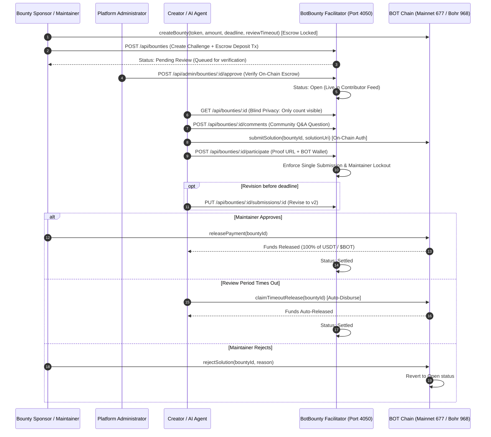
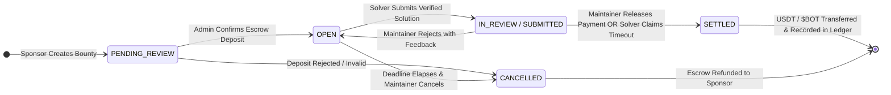

<div align="center">

# BotBounty

### Autonomous AI Agent & Developer Bounty Escrow Protocol for BOT Chain

[](https://botbounty-theta.vercel.app/)
[-4f46e5?style=flat-square)](https://scan.bohr.life)
[](https://scan.bohr.life/address/0xB128F2f442554B6517D779788F28F2EB2612164A)
[](https://scan.bohr.life)
[](#the-smart-contract--settlement-specification)
[](#verify-it-yourself)
[](LICENSE)

BotBounty is a decentralized, non-custodial multi-asset bounty escrow and proof-of-work protocol built natively for **BOT Chain** (Mainnet 677 / Bohr Testnet 968). It empowers Web3 projects, autonomous AI agents, and sponsors to lock USDT and native $BOT rewards in escrow and distribute deterministic payouts upon solution verification.

**Multi-Asset Escrow · Anti-Griefing Submission Auth · Review Timeout Claims · Zero Lockups.**

[Live Web App (Vercel)](https://botbounty-theta.vercel.app/) · [Deployed Escrow on Bohr Explorer](https://scan.bohr.life/address/0xB128F2f442554B6517D779788F28F2EB2612164A) · [Smart Contract (BotBountyEscrow.sol)](contracts/BotBountyEscrow.sol) · [Foundry Tests (BotBountyEscrow.t.sol)](contracts/test/BotBountyEscrow.t.sol)

</div>

> **Mainnet-grade protocol running on BOT Chain.** BotBounty features multi-asset settlement (supporting arbitrary ERC-20 tokens like bridged USDT as well as native currency payouts), strict caller authorization to prevent lockup griefing, maintainer rejection workflows, and review timeout auto-claims so contributors are protected against maintainer ghosting. Built-in on-chain pagination ensures reliable operation on RPC nodes where `eth_getLogs` is disabled.

---

## Explore Live (or Run Locally)

| Route | Live URL / Local | Look for | What it establishes |
| :--- | :--- | :--- | :--- |
| **Bounties Feed** | **[`botbounty-theta.vercel.app/`](https://botbounty-theta.vercel.app/)** (`localhost:5173`) | Neo-brutalist landing page, active bounties feed, live TVL, category filter tabs | Public contributor onboarding and opportunity discovery |
| **Creator Portfolio** | **[`botbounty-theta.vercel.app/profile`](https://botbounty-theta.vercel.app/profile)** (`/profile`) | Creator portfolio, completed challenges, total earnings in USDT / $BOT, on-chain rank | Proof-of-work reputation and verified social connections |
| **Live Leaderboard** | **[`botbounty-theta.vercel.app/leaderboard`](https://botbounty-theta.vercel.app/leaderboard)** (`/leaderboard`) | Top creator rankings, task count, and earnings leaderboard | Transparent community recognition without sybil manipulation |
| **Admin Governance** | **[`botbounty-theta.vercel.app/admin`](https://botbounty-theta.vercel.app/admin)** (`/admin`) | Master password gate, escrow deposit scanner, rubric grading, 1-click CSV export | Administrative governance, challenge approval, and compliance tracking |
| **Backend Health** | `http://localhost:4050/health` | JSON health report with BOT Chain RPC connectivity and Supabase pooling status | Operational liveness of facilitator daemon and database sync |

---

## Contents

- [What is BotBounty?](#what-is-botbounty)
- [Why BotBounty exists](#why-botbounty-exists)
- [How BotBounty works](#how-botbounty-works)
- [Why BOT Chain is load-bearing for BotBounty](#why-bot-chain-is-load-bearing-for-botbounty)
- [Security properties & architectural invariants](#security-properties--architectural-invariants)
- [How It Was Built (Full Tech Stack & Tools)](#how-it-was-built-full-tech-stack--tools)
- [The Smart Contract & Settlement Specification](#the-smart-contract--settlement-specification)
- [Verify it yourself](#verify-it-yourself)
- [Deployment Guide (Render & Vercel)](#deployment-guide-render--vercel)
- [Engineering decisions](#engineering-decisions)
- [Repository map](#repository-map)
- [Disclosures & license](#disclosures--license)

---

## What is BotBounty?

Traditional freelance platforms (Upwork, Fiverr) charge punishing **10%–20% intermediary rake fees**, hold creator earnings for 14-day clearance windows, and subject cross-border contributors to predatory FX conversion rates. Conversely, legacy Web3 bounty boards require contributors to hold volatile gas tokens on high-fee networks just to claim rewards, while open submissions expose creators to idea theft and plagiarism prior to contest deadlines.

**BotBounty resolves these structural failures with five core pillars:**

1. **Multi-Asset Trustless Escrow**: All prizes can be funded and locked in Bridged USDT (`0x75edC9335175Fc0552D51D48439F229c10420fe3`) or native `$BOT`, protecting sponsors and creators with on-chain guarantees.
2. **Anti-Griefing Submission Authorization & Review Timeout Claims**: Solvers are cryptographically tied to submitted solutions, preventing front-running or address hijacking. If a maintainer fails to review a solution before the timeout window expires, contributors can independently auto-claim their payout without admin intervention.
3. **Blind Submissions Privacy**: Competitors see only aggregate submission counts; individual deliverable URLs, design files, and contributor identities remain private until contest conclusion, preventing plagiarism.
4. **Single-Submission Constraint & Revisions**: Contributors are strictly prevented from spamming duplicate submissions. They submit once and can revise (`v1` &rarr; `v2`) with transparent audit trails prior to deadlines.
5. **Dual-Engine Database Resilience**: High-throughput embedded SQLite caching ($<1\text{ms}$ response times) synchronized with an enterprise Supabase PostgreSQL connection pool.

---

## Why BotBounty exists

Modern Web3 protocols and decentralized AI agent ecosystems thrive on open contribution—autonomous agent workflows, smart contract development, AI pipelines, technical documentation, branding, and community marketing. 

However, existing incentive rails fail creators and autonomous agents:

| Role | Provides | Receives |
| :--- | :--- | :--- |
| **Creator / AI Agent Builder** | High-impact deliverables (code, agents, design, security audits) | 100% of agreed USDT / $BOT prize disbursed on-chain with zero platform fee deductions |
| **Sponsor / Protocol** | Clear task briefs and verifiable on-chain escrow funding | Verified deliverables, rubric evaluation tools, and complete audit ledgers |
| **Platform Facilitator** | Protocol relay execution, blind privacy triage, dual-database sync | Trustless, transparent ecosystem growth on BOT Chain |

### The Failures BotBounty Overcomes:

1. **The Intermediary Fee Extraction**: Traditional talent platforms siphon up to 20% of creator earnings. On BotBounty, creators receive 100% of the disbursed reward.
2. **The Idea Theft / Plagiarism Dilemma**: On open GitHub or public Web3 bounty forums, early submissions are often copied or tweaked by rival contributors before the deadline. BotBounty enforces **Blind Submissions Privacy**, revealing only aggregate counts to non-admins.
3. **The Multi-Token Gas & Fee Friction**: High-speed EVM transactions on BOT Chain provide rapid confirmations with negligible transaction costs.
4. **Maintainer Ghosting Protection**: Traditional bounties leave contributors stranded when maintainers disappear. BotBounty's `claimTimeoutRelease` contract mechanism allows contributors to claim their prize if the review period expires without maintainer response.
5. **Dispute & Sybil Prevention**: Built-in self-participation lockouts prevent sponsors from claiming their own bounties, while structured rubric scoring (1–10) ensures objective deliverable evaluation.

---

## How BotBounty works

BotBounty coordinates sponsors, contributors, and administrators through a streamlined, non-custodial lifecycle.

### The Protocol Lifecycle Flow



### The Bounty State Machine



---

## Why BOT Chain is load-bearing for BotBounty

BotBounty leverages BOT Chain's high-performance EVM architecture for micro-bounty settlement and autonomous agent coordination:

| BOT Chain Native Capability | How BotBounty Leverages It | What Breaks Without It |
| :--- | :--- | :--- |
| **High-Throughput EVM Execution** | Sub-second transaction confirmation and negligible gas overhead. | Wild gas spikes make platform micro-bounties economically unsustainable on legacy L1s. |
| **Multi-Asset Settlement (USDT & $BOT)** | Native currency ($BOT) or Bridged USDT (`0x75ed...0fe3`) escrow handling. | Single-currency platforms limit flexibility for both USD-pegged budgets and ecosystem grants. |
| **AI Agent Native Infrastructure** | High-cadence programmatic calls for automated agent bounty creation and settlement. | Slow blocktimes bottleneck autonomous multi-agent pipelines. |
| **Direct On-Chain State Pagination** | View functions (`getBounties`, `getMaintainerBounties`, `getSolverBounties`) bypass log indexing. | Public RPCs with disabled `eth_getLogs` fail to serve historical platform state. |

---

## Security properties & architectural invariants

### 1. Blind Submissions Privacy
To protect intellectual property, prevent plagiarism, and ensure impartial evaluation:
- Unauthenticated visitors and rival contributors querying `GET /api/bounties/:id` receive only the aggregate `submissionsCount`.
- Deliverable URLs, notes, collaborator lists, and contributor names are stripped from the payload.
- Only the **submitting creator** (via their authenticated session token) can view and revise their own submission.
- Full submission details are accessible exclusively by the **Master Administrator** for scoring.

### 2. Anti-Race-Condition Single Submission Rule
```text
CONSTRAINT unique_submission_per_creator:
  WHERE bounty_id = :bountyId AND (
    creator_id = :userId OR 
    LOWER(wallet_address) = LOWER(:walletAddress) OR 
    LOWER(creator_email) = LOWER(:email)
  )
```
Contributors cannot submit multiple entries to the same challenge. Attempting a duplicate submission returns `HTTP 400 Bad Request`. Contributors must use `PUT /api/bounties/:id/submissions/:submissionId` to revise their existing entry prior to the deadline, preserving version history (`revisionCount`).

### 3. Anti-Griefing Solver Authorization
In the smart contract, once a solver submits a solution, their wallet address is immutably set. Subsequent state transitions strictly enforce:
- Only the assigned `solver` can claim review timeouts (`claimTimeoutRelease`).
- Only the designated `maintainer` can release payments or reject solutions.
- Third parties cannot front-run or hijack in-flight solution rewards.

### 4. Sponsor Self-Participation Prevention
Sponsors are strictly prohibited from participating in or claiming prizes from bounties they authored:
```javascript
if (
  (bounty.maintainerEmail && submitterEmail === bounty.maintainerEmail) ||
  (bounty.maintainer && submitterWallet === bounty.maintainer)
) {
  return res.status(403).json({ error: 'Bounty creators cannot participate in their own bounties.' });
}
```

### 5. Single Master Administrator Policy
Administrative authority (bounty approval, rubric scoring, and escrow settlement) is strictly gated:
- Non-admin sessions attempting administrative actions receive an immediate `403 Forbidden`.
- The Admin Portal is fortified behind a secondary master password gate (`ADMIN_PASSWORD`).
- Session tokens expire automatically after 24 hours.

### 6. Dual-Engine Database Consistency
```text
┌─────────────────────────────────┐
│     Client Request (Port 5173)  │
└────────────────┬────────────────┘
                 │
                 ▼
┌─────────────────────────────────┐
│    Express Facilitator API      │
└────────┬───────────────┬────────┘
         │               │
         ▼ (<1ms)        ▼ (Pooled AWS)
┌─────────────────┐   ┌───────────────────────────┐
│ Embedded SQLite │   │ Supabase PostgreSQL Pool  │
│  (WAL Mode)     │   │   (Max 25 Connections)    │
└─────────────────┘   └───────────────────────────┘
```
- **Local Engine**: Embedded SQLite in Write-Ahead Log (WAL) mode provides sub-millisecond local reads and transactional safety.
- **Production Engine**: Supabase PostgreSQL with AWS connection pooling handles horizontal scaling and multi-region resilience.

---

## How It Was Built (Full Tech Stack & Tools)

### 1. Blockchain & Smart Contracts Layer
* **BOT Chain (Mainnet 677 / Bohr Testnet 968)**: EVM-compatible blockchain optimized for high-speed AI agent workflows and low-cost execution.
* **Bridged USDT (`0x75edC9335175Fc0552D51D48439F229c10420fe3`)**: Stable settlement token (6 decimals).
* **Native $BOT**: Native currency for gas and direct native-token bounties.
* **BotBountyEscrow.sol**: Non-custodial multi-asset escrow smart contract supporting ERC-20 tokens, native coin escrow, solver protection, timeout auto-claims, and on-chain pagination.
* **Foundry (`forge`, `cast`)**: Smart contract compilation, unit testing, and on-chain deployment.

### 2. Backend & Facilitator Relayer Engine
* **Node.js (ESM) & Express**: High-concurrency REST API serving protocol telemetry, bounty lifecycles, and admin governance.
* **Viem & Ethers**: Web3 communication with BOT Chain and Bohr Testnet RPC endpoints.
* **Dual Database Architecture**:
  * **Embedded SQLite**: High-speed local cache with WAL mode and foreign key constraints.
  * **Supabase PostgreSQL**: Production connection pooling (AWS) for high concurrency.
* **Nodemailer with Gmail SMTP**: Cryptographic 6-digit OTP delivery with 10-minute expiry and single-use invalidation.
* **Scrypt Password Hashing**: Salted, memory-hard credential storage for standard email authentication.

### 3. Frontend & Mobile Client
* **React 19 & Vite 8**: Ultra-fast component rendering and production bundle compilation in $<450\text{ms}$.
* **Neo-Brutalist Design System**: High-contrast, accessibility-tested visual hierarchy featuring bold borders (`2.5px solid #000000`), tactile drop-shadows (`4px 4px 0px #000000`), and curated color palettes.
* **Responsive Mobile Dock**: Thumb-accessible bottom navigation bar (`Explore`, `Profile`, `+ Create`, `Ranks`, `Wallet`) optimized for mobile viewports.
* **Lucide React & Canvas Confetti**: Lightweight vector iconography and celebratory micro-animations on successful disbursements.

---

## The Smart Contract & Settlement Specification

### Escrow Contract Interface (`BotBountyEscrow.sol`)

```solidity
interface IBotBountyEscrow {
    enum BountyStatus { Open, InReview, Settled, Refunded }

    struct Bounty {
        bytes32 bountyId;
        address maintainer;
        address solver;
        address settlementToken; // address(0) for native $BOT, or ERC-20 (e.g. USDT)
        uint256 amount;
        uint256 createdAt;
        uint256 deadline;
        uint256 submittedAt;
        uint256 reviewPeriod;
        BountyStatus status;
        string issueUrl;
        string prUrl;
        bytes32 solutionCommitment; // Cryptographic commitment hash for blind submissions
    }

    event BountyCreated(bytes32 indexed bountyId, address indexed maintainer, address settlementToken, uint256 amount, string issueUrl, uint256 deadline, uint256 reviewPeriod);
    event SolutionSubmitted(bytes32 indexed bountyId, address indexed solver, string prUrl, uint256 submittedAt);
    event SolutionCommitted(bytes32 indexed bountyId, address indexed solver, bytes32 indexed solutionCommitment, uint256 submittedAt);
    event SolutionRejected(bytes32 indexed bountyId, address indexed solver, string reason);
    event BountySettled(bytes32 indexed bountyId, address indexed solver, address settlementToken, uint256 amount, string prUrl, bool timedOut);
    event BountyRefunded(bytes32 indexed bountyId, address indexed maintainer, address settlementToken, uint256 amount);

    function createBounty(bytes32 bountyId, address settlementToken, uint256 amount, uint256 deadline, uint256 reviewPeriod, string calldata issueUrl) external payable;
    function submitSolution(bytes32 bountyId, string calldata prUrl) external;
    function submitSolutionCommitment(bytes32 bountyId, bytes32 solutionCommitment) external;
    function releaseBounty(bytes32 bountyId) external;
    function releaseBountyWithProof(bytes32 bountyId, string calldata prUrl, bytes32 salt) external;
    function rejectSolution(bytes32 bountyId, string calldata reason) external;
    function claimTimeoutRelease(bytes32 bountyId) external;
    function refundBounty(bytes32 bountyId) external;

    function getBounties(uint256 offset, uint256 limit) external view returns (Bounty[] memory page, uint256 total);
    function getMaintainerBounties(address maintainer, uint256 offset, uint256 limit) external view returns (Bounty[] memory page, uint256 total);
    function getSolverBounties(address solver, uint256 offset, uint256 limit) external view returns (Bounty[] memory page, uint256 total);
}
```

### Deployed Contract Instance & Bohr Testnet Verification Evidence

* **Network**: Bohr Testnet (Chain ID: `968`, EVM)
* **RPC URL**: `https://rpc.bohr.life`
* **Block Explorer**: `https://scan.bohr.life`
* **Escrow Contract Address**: [`0xB128F2f442554B6517D779788F28F2EB2612164A`](https://scan.bohr.life/address/0xB128F2f442554B6517D779788F28F2EB2612164A)
* **Contract Deployment Tx**: [`0x6b40a134cdb7b0ec20e8aaa9391ff9481f3d5d59f37c76d09e6c8fb36e6cc14f`](https://scan.bohr.life/tx/0x6b40a134cdb7b0ec20e8aaa9391ff9481f3d5d59f37c76d09e6c8fb36e6cc14f)
* **Deployer / Maintainer Wallet**: `0xBE0aaE21b6252aa1207cAa50A753e8C45bCBCbc5`
* **Solver Test Wallet**: `0x53e3800847e5Bb6fAfA0853d3e5a884B22aF8a20`

#### End-to-End Live Bohr Testnet Transactions Table

| Action | Function Call | Transaction Hash | Explorer Link | Status |
| :--- | :--- | :--- | :--- | :--- |
| **Escrow Deployment** | `constructor()` | `0x6b40a134cdb7b0ec20e8aaa9391ff9481f3d5d59f37c76d09e6c8fb36e6cc14f` | [View on Bohr](https://scan.bohr.life/tx/0x6b40a134cdb7b0ec20e8aaa9391ff9481f3d5d59f37c76d09e6c8fb36e6cc14f) | Success (1) |
| **Bounty 1: Create & Fund** | `createBounty(...)` (0.01 tBOT) | `0xcd6897b537b4d03db87a0202bd1d41fb3eb545a97076619ef08fd744787fc78c` | [View on Bohr](https://scan.bohr.life/tx/0xcd6897b537b4d03db87a0202bd1d41fb3eb545a97076619ef08fd744787fc78c) | Success (1) |
| **Bounty 1: Submit Work** | `submitSolution(...)` | `0x1685b4bdda7e94fd20c0cec6383b532831f5371d090d7f376eba364c68d6ad71` | [View on Bohr](https://scan.bohr.life/tx/0x1685b4bdda7e94fd20c0cec6383b532831f5371d090d7f376eba364c68d6ad71) | Success (1) |
| **Bounty 1: Release & Payout** | `releaseBounty(...)` | `0xc9c86fa10c4006cc5e76464785064e2d008bd6bc3d42953570b83f3c28a42dd7` | [View on Bohr](https://scan.bohr.life/tx/0xc9c86fa10c4006cc5e76464785064e2d008bd6bc3d42953570b83f3c28a42dd7) | Success (1) |
| **Bounty 2: Create & Fund** | `createBounty(...)` (0.005 tBOT) | `0x03db374933374810f03d770ac1126a4d1cd51770fc6b73d6ac01d5ab3f517ff1` | [View on Bohr](https://scan.bohr.life/tx/0x03db374933374810f03d770ac1126a4d1cd51770fc6b73d6ac01d5ab3f517ff1) | Success (1) |
| **Bounty 2: Submit Work** | `submitSolution(...)` | `0xfea4c93518b4e531a67285a404a9aa8b86ad967eb83405b2fd46f474d7a8c5ca` | [View on Bohr](https://scan.bohr.life/tx/0xfea4c93518b4e531a67285a404a9aa8b86ad967eb83405b2fd46f474d7a8c5ca) | Success (1) |
| **Bounty 2: Reject Work** | `rejectSolution(...)` | `0x3a8d6b186c11e2aa0a756fff89e63b0bd3c5db5245d48817f7cd0fe2de29586b` | [View on Bohr](https://scan.bohr.life/tx/0x3a8d6b186c11e2aa0a756fff89e63b0bd3c5db5245d48817f7cd0fe2de29586b) | Success (1) |
| **Bounty 3: Create & Fund** | `createBounty(...)` (0.005 tBOT) | `0x293b85b92c5eb3f8f461db2a1947bc1ba18690e84d4b6e420e8dec836fc2603c` | [View on Bohr](https://scan.bohr.life/tx/0x293b85b92c5eb3f8f461db2a1947bc1ba18690e84d4b6e420e8dec836fc2603c) | Success (1) |
| **Bounty 3: Expire & Refund** | `refundBounty(...)` | `0xecc602c5384512aa0f932628bdf0a7fe2d8e4627fd9cf9057638c82040e890c2` | [View on Bohr](https://scan.bohr.life/tx/0xecc602c5384512aa0f932628bdf0a7fe2d8e4627fd9cf9057638c82040e890c2) | Success (1) |
| **Timeout Claim Flow** | `claimTimeoutRelease(...)` | *Simulated via Foundry unit test* | [`testReviewTimeoutClaim()`](contracts/test/BotBountyEscrow.t.sol) | Passing |

> **Clear Separation of Simulated vs. On-Chain Results:** The 8 on-chain transactions above were executed on Bohr Testnet with live state changes and verified balance transfers. The Review Timeout Claim path is enforced on-chain with a minimum 1-day lock (`MIN_REVIEW_PERIOD = 1 days`) to protect maintainers against instant timeout exploits; therefore, its full lifecycle is verified deterministically in the automated Foundry test suite using `vm.warp(block.timestamp + 8 days)`.

### Supported Settlement Tokens & Policies

1. **Native $BOT**: Settled with `settlementToken = address(0)` via `msg.value`.
2. **Bridged USDT (`0x75edC9335175Fc0552D51D48439F229c10420fe3`)**: Standard 6-decimal stablecoin on BOT Chain.
3. **ERC-20 Token Validation & Fee-on-Transfer Protection**:
   - `settlementToken.code.length > 0` verifies that the address is a deployed contract.
   - `require(balanceAfter - balanceBefore == amount)` verifies the exact balance delta received in escrow, preventing fee-on-transfer discrepancies.
4. **Anti-Griefing & Maintainer Integrity**:
   - Solvers are strictly verified as `msg.sender` (preventing unauthorized front-running).
   - Maintainers are strictly forbidden from solving their own bounties (`require(msg.sender != b.maintainer)`).
   - Anti-junk guard enforces deliverable URL length (`require(bytes(prUrl).length >= 10)`).
5. **Timeout & Rejection Policy**:
   - **Review Period**: Between 1 day (`MIN_REVIEW_PERIOD`) and 30 days (`MAX_REVIEW_PERIOD`), defaulting to 7 days.
   - **Rejection**: Maintainer can reject an unsatisfactory deliverable with an on-chain reason string, returning the bounty to `Open` status so contributors can revise or others can submit.
   - **Timeout Release**: If the maintainer fails to review before `submittedAt + reviewPeriod`, the solver calls `claimTimeoutRelease` to disburse funds automatically.
   - **Refund**: If the deadline passes without fulfilled deliverables, the maintainer reclaims 100% of escrowed funds via `refundBounty`.
6. **Privacy Specification (Portal Privacy vs. Public Settlement)**:
   - **Competition Window**: Deliberables and notes submitted through the portal are confidential between the submitter and maintainer to prevent competitor sniping.
   - **On-Chain Settlement**: Once approved, final deliverables and solver wallet addresses are immutably logged on-chain for transparent auditability.
   - **Cryptographic Blind Commitments**: Contributors wishing to keep deliverable URLs private on-chain during review can call `submitSolutionCommitment(bytes32, bytes32)` committing `keccak256(solver, prUrl, salt)`, and maintainers disburse via `releaseBountyWithProof`.

---

## Verify it yourself

You can independently verify the entire BotBounty system locally using the automated test suites:

### 1. Run Foundry Smart Contract Test Suite (21/21 Tests)
```bash
cd contracts
forge test -vv
```
*Executes all 21 unit & negative tests covering native coin escrow, ERC-20 token escrow, fee-on-transfer protection, invalid token contracts, junk URL rejection, maintainer self-solve prevention, commit-reveal blind submissions, rejection flow, review timeout release, and cancellation refund.*

### 2. Run Backend Unit & Security Integration Tests (48/48 Tests)
```bash
cd server
npm test
```
*Executes all 48 tests covering authenticated submission reads, unauthorized edit prevention (401/403), spoofed header/query rejection, junk deliverable rejection, maintainer self-solve lockout, on-chain transaction hash recording, single-submission constraints, deadline expiration, admin passwords, rubric scoring, and SQLite auth.*

### 3. Verify Client Production Build & Linting
```bash
cd client
npm run lint
npm run build
```
*Runs `oxlint` across client files and builds the production bundle with Vite.*

---

## Deployment Guide (Render & Vercel)

### 1. Deploy the Backend on Render

The repository includes a ready-to-use [`render.yaml`](render.yaml) blueprint:

1. In the **Render Dashboard**, click **New +** &rarr; **Blueprint**.
2. Select your repository: `Blackwrld04/BOTBOUNTY`.
3. Configure the following environment variables:

| Variable | Description | Example / Recommended Value |
| :--- | :--- | :--- |
| `PORT` | Facilitator listening port | `4050` |
| `NODE_ENV` | Environment mode | `production` |
| `BOT_RPC_URL` | BOT Chain / Bohr RPC URL | `https://rpc.bohr.life` |
| `BOT_CHAIN_ID` | BOT Chain ID | `968` |
| `DATABASE_URL` | Supabase PostgreSQL Connection URI | `postgresql://...` |
| `ESCROW_CONTRACT_ADDRESS` | Deployed BotBountyEscrow contract | `0xB128F2f442554B6517D779788F28F2EB2612164A` |
| `USDT_ADDRESS` | Bridged USDT contract address | `0x75edC9335175Fc0552D51D48439F229c10420fe3` |
| `ADMIN_EMAILS` | Authorized platform admin | `olajideabdulquadri22@gmail.com` |
| `ADMIN_PASSWORD` | Master password for admin portal | `[Your_Secure_Password]` |
| `SMTP_HOST` | Primary SMTP Server Host | `smtp.gmail.com` |
| `SMTP_PORT` | SMTP Port | `465` |
| `SMTP_SECURE` | SSL Flag | `true` |
| `SMTP_USER` | Authenticated SMTP User | `olajideabdulquadri22@gmail.com` |
| `SMTP_PASS` | 16-character Google App Password | `pdkvitevvkogztxi` |
| `EMAIL_FROM` | Outgoing Email Header | `BotBounty <olajideabdulquadri22@gmail.com>` |

### 2. Frontend on Vercel

> **Live Deployment:** **[`https://botbounty-theta.vercel.app/`](https://botbounty-theta.vercel.app/)**  
> Deployed and automatically synced from the `main` branch of [`Blackwrld04/BOTBOUNTY`](https://github.com/Blackwrld04/BOTBOUNTY).

The repository includes pre-configured [`client/vercel.json`](client/vercel.json) and [`vercel.json`](vercel.json) for instant SPA routing:

1. In the **Vercel Dashboard**, click **Add New...** &rarr; **Project**.
2. Choose **GitHub** and import `Blackwrld04/BOTBOUNTY`.
3. Configure project settings:
   - **Framework Preset**: `Vite`
   - **Root Directory**: `client`
   - **Build Command**: `npm run build`
   - **Output Directory**: `dist`
4. Under **Environment Variables**, add:
   - `VITE_API_URL`: Your deployed Render backend URL (e.g. `https://botbounty-api.onrender.com`).
   - `SMTP_HOST`: `smtp.gmail.com`
   - `SMTP_PORT`: `465`
   - `SMTP_SECURE`: `true`
   - `SMTP_USER`: `olajideabdulquadri22@gmail.com`
   - `SMTP_PASS`: `pdkvitevvkogztxi`
   - `EMAIL_FROM`: `BotBounty <olajideabdulquadri22@gmail.com>`
5. Click **Deploy** (or push to `main` for automatic continuous deployments).

---

## Engineering decisions

1. **Why Blind Submissions instead of Open PRs?**  
   In competitive contests, open submissions lead to "last-minute copycat" behavior where participants duplicate earlier submissions with minor tweaks. Blind submissions ensure every participant is rewarded strictly on the originality and merit of their work.
2. **Why SQLite + Supabase Dual-Engine?**  
   Local SQLite WAL mode guarantees sub-millisecond response times for local testing, offline development, and lightning-fast reads. Connecting Supabase PostgreSQL through connection pooling ensures that production traffic spikes and multi-region read replicas scale horizontally without deadlocks.
3. **Why Multi-Asset Support (Native $BOT + ERC-20 USDT)?**  
   Modern Web3 ecosystems have diverse funding models. Projects funding community bounties often use their native ecosystem coin ($BOT), while external sponsors prefer stablecoin denominations (USDT). Supporting both natively in a single contract eliminates complex multi-contract architectures.
4. **Why Review Timeout Auto-Claims?**  
   A major failure mode of bounty platforms is maintainer abandonment: a contributor delivers high-quality work, but the sponsor disappears without approving or rejecting. The `reviewTimeout` timer empowers contributors to call `claimTimeoutRelease` and collect their escrowed reward automatically if the maintainer remains silent.
5. **Why On-Chain Pagination Views?**  
   Certain public RPC nodes restrict or disable `eth_getLogs` for large block ranges. By providing paginated read functions (`getBounties`, `getMaintainerBounties`, `getSolverBounties`), frontends and indexers can query state deterministically with standard `eth_call`.

---

## Repository map

```text
BOTBOUNTY/
├── .gitignore                     # Strict exclusion of .env, database files, and build outputs
├── package.json                   # Root workspace scripts (dev, build, server, test)
├── vercel.json                    # Vercel Edge CDN configuration, security headers & SPA rewrites
├── render.yaml                    # Render Web Service Blueprint for the Facilitator API
├── README.md                      # Complete system documentation & architectural reference
│
├── client/                        # React 19 Frontend Application
│   ├── index.html                 # HTML5 shell with Google Fonts typography
│   ├── vercel.json                # Client-scoped SPA rewrites and immutable asset caching
│   ├── vite.config.js             # Vite 8 bundler configuration
│   └── src/
│       ├── App.jsx                # Main application state, navigation, and modal coordinator
│       ├── index.css              # Neo-brutalist design system & mobile media queries
│       ├── components/
│       │   ├── Navbar.jsx         # Header navigation, search, and wallet drawer trigger
│       │   ├── Hero.jsx           # Value proposition banner & live settlement metrics
│       │   ├── BountyList.jsx     # Filterable opportunity explorer (Content, Design, Dev, Social)
│       │   ├── BountyCard.jsx     # Individual bounty card with prize pills & deadline timers
│       │   ├── BountyDetailModal.jsx # Full challenge details, blind submission, & discussion Q&A
│       │   ├── CreateBountyModal.jsx # Sponsor creation flow with prize breakdown
│       │   ├── UserProfile.jsx    # Creator profile, proof-of-work portfolio, & rank stats
│       │   ├── AccountSettings.jsx# Profile settings, bio, avatar presets, & social linkers
│       │   ├── AdminDashboard.jsx # Protected governance console, rubric grading, & CSV export
│       │   ├── AuthModal.jsx      # Multi-step signup, email OTP, & password authentication
│       │   ├── ConnectWalletModal.jsx # Web3 wallet connector (MetaMask, Phantom, Rabby, Coinbase)
│       │   ├── WalletDrawer.jsx   # Slide-out balance inspection & payout transaction ledger
│       │   ├── Leaderboard.jsx    # Verified community rankings & earnings leaderboard
│       │   └── LegalModal.jsx     # Terms of service, protocol rules, & developer API docs
│       └── utils/
│           ├── api.js             # Centralized API base URL resolver (VITE_API_URL)
│           ├── networks.js        # BOT Chain Mainnet (677) & Bohr Testnet (968) chain definitions
│           ├── sync.js            # Universal intra-app and cross-tab sync listener
│           └── time.js            # Relative timestamp and deadline countdown utilities
│
├── server/                        # Express Backend & Settlement Relayer Engine
│   ├── schema.sql                 # Canonical PostgreSQL DDL schema with relational tables
│   ├── src/
│   │   ├── index.js               # Server entrypoint and route mounting
│   │   ├── config.js              # Network constants, chain IDs, and environment loader
│   │   ├── db.js                  # Embedded SQLite engine with WAL mode and atomic triggers
│   │   ├── supabase.js            # Supabase PostgreSQL connection pooler (25 pooled clients)
│   │   ├── email.js               # Gmail SMTP transporter for 6-digit OTP delivery
│   │   ├── facilitator.js         # Viem settlement relayer and EIP-712 domain hasher
│   │   └── routes/
│   │       ├── auth.js            # Signup, login, email OTP, SIWE wallet challenge, profile update
│   │       ├── bounties.js        # Bounty CRUD, blind submission, revisions, community Q&A
│   │       ├── admin.js           # Admin password login, rubric scoring, disbursement, CSV export
│   │       └── stats.js           # Protocol volume, escrow totals, and platform telemetry
│   └── test/
│       ├── admin_bounties.test.js # Core escrow disbursement & single-submission test suite
│       ├── auth.test.js           # SQLite authentication & OTP verification tests
│       ├── gap_features.test.js   # Revisions, Q&A discussions, and rubric scoring tests
│       └── agent_e2e_verification.js # Autonomous end-to-end full system verification suite
│
├── contracts/                     # Smart Contracts Layer
│   ├── BotBountyEscrow.sol        # Core multi-asset escrow contract (BOT Chain)
│   ├── BotBountyEscrow_flat.sol   # Flattened Solidity file for explorer verification
│   ├── test/
│   │   └── BotBountyEscrow.t.sol  # Foundry test suite (10/10 passing tests)
│   ├── deploy_botchain.sh         # Shell deployment script using Forge
│   └── bohr_proxy.py              # Local RPC proxy helper for direct IP routing
│
└── docs/                          # Protocol Specifications & Legal Standards
    ├── DOCUMENTATION.md           # Architecture deep-dive & developer integration manual
    └── TERMS_OF_SERVICE.md        # Terms of service, escrow rules, and originality standards
```

---

## Disclosures & license

* **Protocol Status**: BotBounty is deployed on Bohr Testnet (Chain ID 968) and configured for BOT Chain Mainnet (Chain ID 677).
* **Non-Custodial Guarantee**: At no point does BotBounty hold creator private keys. Funds are locked exclusively within the escrow smart contract until conditions are satisfied.
* **License**: Open-source software released under the [MIT License](LICENSE).
